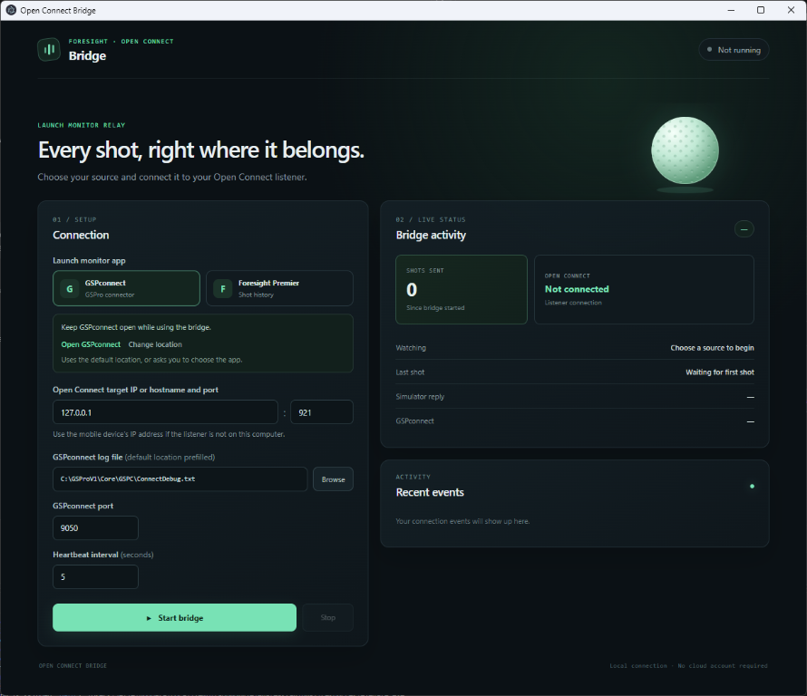

# Open Connect Bridge

Send shots from your Foresight launch monitor to an Open Connect-compatible golf simulator, using either GSPconnect or Foresight Premier.



**Choose your source. Connect your simulator. Play.**

- **Simple setup:** Launch GSPconnect or Foresight Premier right from the bridge.
- **Live feedback:** See connection status, shots, and recent events at a glance.
- **Play your way:** Connect to a simulator on this computer or another device on your network.

## Get started

1. Download the latest app from [GitHub Releases](https://github.com/jef/open-connect-bridge/releases) and open it. The app doesn't require Node.js or Python. Windows requires the WebView2 runtime.
2. Select **GSPconnect** or **Foresight Premier** in the bridge.
3. Open your selected app:
   - **GSPconnect:** Keep the connector open while using the bridge.
   - **Foresight Premier:** Sign in, connect your launch monitor, and open a **Shot Analysis** session. Shots need to be logged there to register in the bridge.
4. Start your Open Connect-compatible simulator, then select **Start bridge**. New shots should appear in the bridge's live status.

Use the **Open** button to launch your selected app from the bridge. If it isn't found automatically, choose its location when prompted. You can change that location later with **Change location**.

Stop the bridge before switching between GSPconnect and Foresight Premier.

The window adjusts its height as the contents change and remains manually resizable. On smaller screens, scroll to see any content that doesn't fit.

## Connecting to another device

If your simulator runs on the same computer, leave the target at `127.0.0.1:921` unless your simulator uses a different port.

If it runs on a phone, tablet, or another computer, enter that device's reachable IP address and Open Connect port instead. The devices must be able to reach each other, and the simulator must allow the connection. Stop and start the bridge after changing the address or port.

## Troubleshooting

- **No shots?** Make sure GSPconnect is open, or that Premier is in a Shot Analysis session. The bridge only forwards new shots; Premier shots already in history when it starts are skipped.
- **Not connected?** Check that your simulator's Open Connect listener is running and that the target address and port are correct.
- **App not found?** Use **Change location** to select GSPconnect or Foresight Premier. The bridge also lets you browse for a log or history file if your installation uses a nonstandard location.

Windows and macOS builds are unsigned, so your operating system may show a security warning. On Linux, the tarball requires WebKitGTK 4.1 and the other Tauri runtime libraries provided by your distribution.

GSPconnect and Foresight Premier run on Windows, so only the Windows build detects their default locations. On macOS and Linux, use **Browse** to choose the log or history file, for example from a shared folder.

## Building from source

Install [Rust](https://rustup.rs/) and the [Tauri prerequisites](https://v2.tauri.app/start/prerequisites/) for your operating system. Install the Rust Tauri CLI with `cargo install tauri-cli --version 2.12.4 --locked`, then run:

```text
cargo tauri build
cargo test --locked --manifest-path src-tauri/Cargo.toml
cargo clippy --locked --manifest-path src-tauri/Cargo.toml --all-targets -- -D warnings
```

For the command-line bridge, use `cargo run --manifest-path src-tauri/Cargo.toml --bin bridge-cli -- --help`. macOS builds require macOS; Linux builds require Linux.

The Rust bridge has simulated integration coverage but has not yet been verified with real launch-monitor hardware.
